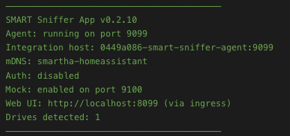
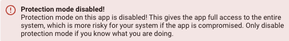
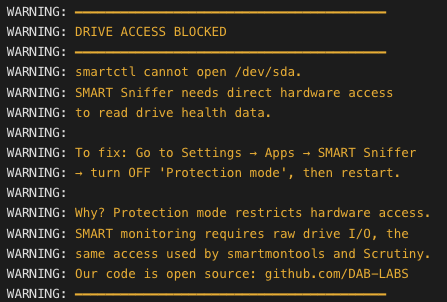

[](LICENSE)
[](https://github.com/DAB-LABS/smart-sniffer-app/releases)
[](https://www.home-assistant.io/)

## Your Drives' Health, On Its Own Page

The app shows your drives' health on its own page. The integration turns it into entities, alerts and history.

This app reads S.M.A.R.T. data from the drives inside your Home Assistant machine (the boot SSD or NVMe that HAOS runs on, and any other drive it can see) and shows it in the **Control Center**, the app's own page in Home Assistant. No SSH access, no scripts, no external tools: install the app and open the page.

The page also shows the drives on your other machines that run the SMART Sniffer agent, and replicas: fake drives for testing Home Assistant. The **SMART Sniffer integration** is optional. It adds entities, history, notifications and automations, and the page adds your machines and replicas to it with one click.


> **Got drives on other machines?** If you also run a NAS, Proxmox host, Mac, Linux box or Windows machine, the [SMART Sniffer Agent](https://github.com/DAB-LABS/smart-sniffer) installs directly on those hosts. One small binary per machine, no Docker required. The app finds them on your network when you ask and shows their drives next to your own, and the same integration takes in both.

## Which Component Do I Need?

SMART Sniffer has three components. Use whichever ones fit your setup; they all work together.

| Your setup | What to install | Repo |
|---|---|---|
| Just want to see your drives' health | **This App** | You're here |
| Drives inside your HAOS machine | **This App** (HAOS app) | You're here |
| Drives on a NAS, Proxmox host, Mac, Linux box or Windows machine | **Agent** (standalone binary) on that machine; the app shows them as field agents | [smart-sniffer](https://github.com/DAB-LABS/smart-sniffer) |
| Drive health as Home Assistant entities, sensors, alerts and history | **Integration** (HACS) | [smart-sniffer](https://github.com/DAB-LABS/smart-sniffer) |

**Common combinations:**

- **Bare metal NUC or mini PC running HAOS**: the App. Add the Integration for entities and alerts.
- **HAOS in a VM with drives on the host**: the Agent on the host, and the App to see it (as a field agent) or the Integration, or both.
- **HAOS on bare metal and a NAS on the network**: the App for the HAOS drive and the Agent on the NAS. The App's page shows both; the Integration turns both into entities.
- **Several machines with drives**: the Agent on each machine, and the App or the Integration to bring them together.

## Installation

### Step 1: Add the Repository

1. In Home Assistant, go to **Settings > Apps > App Store**
2. Click the **three-dot menu** (top right) > **Repositories**
3. Add this URL:

```
https://github.com/DAB-LABS/smart-sniffer-app
```

4. Click **Add**, then close the dialog

### Step 2: Install the App

1. Find **SMART Sniffer App** in the app store (you may need to refresh)
2. Click **Install**
3. Once installed, click **Start**
4. Click **Open Web UI**, or turn on **Show in sidebar** to open the Control Center from the sidebar. It shows one card per drive.
5. If a drive shows **Health not known**, or you see **"DRIVE ACCESS BLOCKED"** in the logs, turn off **Protection Mode**: go to **Settings > Apps > SMART Sniffer > Protection mode**, switch it **OFF**, then restart the app (see [Security & Permissions](#security--permissions) for details)

### Step 3 (optional): Install the Integration

The integration turns drive data into Home Assistant entities, history, notifications and automations. Both this app and the standalone agent report through it.

1. Install [HACS](https://hacs.xyz) if you don't have it
2. In HACS, click the **three-dot menu** > **Custom repositories**
3. Add `https://github.com/DAB-LABS/smart-sniffer` with category **Integration**
4. Search for **SMART Sniffer** in HACS, download it, and restart Home Assistant
5. In the Control Center, click the grey exit icon beside a drive card's type label and confirm. This machine's drives are added to Home Assistant, and the icon turns blue, linking to each drive's device page.
6. Home Assistant may also discover the app's agent on its own under **Settings > Devices & Services**. To add it by hand: **Settings > Devices & Services > Add Integration > SMART Sniffer**, then enter the host and port from the app's startup log (`Integration host:`), for example `0449a086-smart-sniffer-agent` and port `9099`.

## How It Works


The app runs `smartctl` inside its container to read SMART attributes from the host's drives, through the same agent you can install on other machines. The Control Center reads that agent, the field agents you added and the replica agent, and judges every drive with the integration's own rules, which are built into the app, so the page and Home Assistant always give the same verdict.

The SMART Sniffer integration, when installed, polls the same agents and creates Home Assistant entities (sensors, binary sensors and diagnostic attributes) for dashboards, automations and alerts. The agent advertises itself with mDNS (Zeroconf), so the integration can discover it on most networks.



## The Control Center

One grid of cards, one per drive (including USB drives mounted under `/media` or a data disk, also after **Move data disk** from HA) and per ZFS pool, from this machine (`HAOS`), your field agents and the replicas, each with its health word (Attention, Maybe, Health OK or Health not known), every row that caused it, its disk space, and Details for the full readings. Drag cards by their grip to arrange them; the eye hides a card for now, the trash removes it for good with a second click on **Remove?**, and for a card in Home Assistant also offers to disable its device there, or delete it once the agent no longer reports it. Rename a card or a field agent's machine in place by clicking its title or machine label; a drive in Home Assistant takes the name there as its device name, and a name given in Home Assistant shows on the card.

- **Field agents**: your other machines running the agent. The **+** card scans your network for them when you open it, and only then; you can also add one by hand. Agents with a token ask for it on their card. They are stored in the app's options.
- **Replicas**: fake drives and pools for testing Home Assistant, switched between scenarios with one click. Six ship with the app; you can upload your own, drop files into `/share/smart-sniffer/replicas`, or save any card as a file, a real drive's with its serial number and WWN replaced.

- **Thresholds**: each drive's alert thresholds, edited in its Details. A drive in Home Assistant keeps them in the integration, so the card and Home Assistant agree; any other drive keeps them in the app's options. Accept current readings makes what is flagged the drive's new normal.
- **Agentic access**: a footer link opens everything the page knows as one JSON document for an AI assistant or a script, with a guide to the fields, Copy and Download. It needs your Home Assistant login and never includes tokens.
- **Connect by hand**: Details on a drive or pool card gives the host and port (and this app's mDNS name) to type into the integration, with copy buttons; the line at the top of the page has the same for this app's agent.

See [DOCS.md](smart_sniffer_agent/DOCS.md) for the details, including how to put the page in the sidebar or on a dashboard.

## Configuration

| Option | Default | Description |
|---|---|---|
| Agent Port | `9099` | Port the agent listens on |
| Bearer Token | _(empty)_ | Optional token for this machine's agent. Must match the token in the integration's entry for it. |
| Scan Interval | `60` | How often SMART data is refreshed (seconds) |
| Replica Agent Port | `9100` | Port of the replica agent inside the app. Not exposed on your network. |
| Field Agents | _(empty)_ | Other machines running the SMART Sniffer agent. Added from the Control Center. |
| Card Order | _(empty)_ | The order of the cards. Set by dragging them in the Control Center. |
| Hidden Cards | _(empty)_ | Cards hidden with the eye in the Control Center. |
| Thresholds | _(empty)_ | Alert thresholds of drives that are not in Home Assistant. Set from a drive's Details. |
| Card Names | _(empty)_ | Names given to cards in the Control Center. A drive or pool in Home Assistant also takes the name as its device name. |
| Machine Names | _(empty)_ | Names given to field agents' machines in the Control Center. |

## Security & Permissions

SMART Sniffer needs direct hardware access to read drive health data. This is not optional; it is how SMART monitoring works on Linux. Every tool that reads SMART data (`smartmontools`, `hdparm`, Scrutiny) needs the same access.

**What the app needs and why:**

| Permission | Purpose |
|---|---|
| `SYS_RAWIO` | Send SCSI commands to SATA and SAS drives |
| `SYS_ADMIN` | Send admin commands to NVMe drives |
| `full_access` | Open drive device nodes (`/dev/sda`, `/dev/nvme0`) |
| `hassio_api` | Network information for the scan's prefilled block, and the app's own options, where field agents are stored |
| `homeassistant_api` | Adds this app's agents, replicas and field agents to the integration, and finds their device pages |
| `share` | Your replica folder, `/share/smart-sniffer/replicas` |
| `media` | Disk space of the USB drives Home Assistant mounts under `/media`, read-only |
| Protection Mode OFF | May be needed to allow the drive permissions above to take effect |

**What the app does NOT do:**

- Does not write to your drives
- Does not contact other machines on your network unless you ask: a scan or a check from the + card, or a read of the field agents you added
- Does not send data outside your network or phone home
- Outside its own container, uses no files but those in your replica folder

**Why you may need to turn off Protection Mode:**

On some hardware, Home Assistant's Protection Mode stops the container from opening drive device nodes. The app can then see that your drive exists but cannot read its SMART data: you'll see a "DRIVE ACCESS BLOCKED" warning in the logs and the drive shows Health not known.

If this affects you, go to **Settings > Apps > SMART Sniffer**, switch Protection Mode **OFF**, then restart the app.


After disabling Protection Mode, you'll see this warning. That's expected:



**Our commitment to transparency:**

SMART Sniffer is fully open source. The Go agent, startup scripts, AppArmor profile and integration code are all published here for anyone to audit. We ship a custom AppArmor security profile that documents exactly what the container accesses. We're committed to requesting only the minimum permissions needed and being upfront about why each one is required.

## Troubleshooting

**Drives show "Health not known" or no SMART data.** Check the app logs for "DRIVE ACCESS BLOCKED". If you see it, turn off Protection Mode (see above) and restart the app.



**No drives detected.** The app needs `SYS_RAWIO` to read SMART data from host drives. This is configured automatically. Check the app logs if drives aren't appearing.

**The scan finds nothing.** Check that the agent runs on that machine on the port you scanned and that no firewall blocks it. For a machine on another subnet, use **Add by hand** in the + card.

**Port conflicts.** If port 9099 is already in use, change the Agent Port in configuration and update the integration to match.

**USB drives showing Health not known.** Many USB enclosures block SMART passthrough at the hardware level. This is a limitation of the USB bridge chip, not the app.

**mDNS not discovered.** The app uses your HA hostname (Settings > System > General) to create a unique mDNS name. If you have multiple HA instances, make sure each has a different hostname. If auto-discovery still doesn't work, add the agent from the Control Center or by hand as described in Step 3 above.

## Links

- [SMART Sniffer Agent & Integration](https://github.com/DAB-LABS/smart-sniffer): standalone agent for remote machines and the HACS integration
- [CHANGELOG](CHANGELOG.md)
- [Report an Issue](https://github.com/DAB-LABS/smart-sniffer-app/issues)
