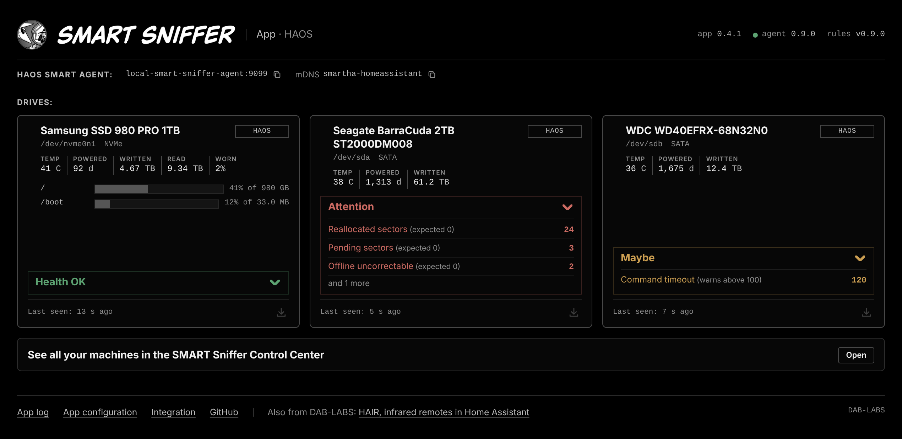
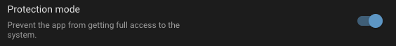

<p align="center">
  
</p>

**The drives inside your Home Assistant box, watched.**<br>
*Sniff early. Sniff often.*

[](https://github.com/DAB-LABS/smart-sniffer-app/releases/latest)
[](LICENSE)
[](https://www.home-assistant.io/)
[](https://github.com/DAB-LABS/smart-sniffer)

---

The SMART Sniffer App watches the drives of the machine Home Assistant runs on: the boot SSD or NVMe that HAOS lives on, the data disk, and any USB drive Home Assistant mounts. It reads their S.M.A.R.T. data, judges every drive with the same rules as the SMART Sniffer integration, and shows them on its own page. No SSH, no scripts, no external tools.

<br>

## Better together

SMART Sniffer comes in two parts.

- **The [SMART Sniffer integration](https://github.com/DAB-LABS/smart-sniffer)** (from HACS) owns every machine. Its **Control Center** in the sidebar shows every drive of every machine, with sensors, history, notifications, automations, replicas for testing and Agentic access.
- **This App** does what only an App can do on Home Assistant OS: it runs the SMART Sniffer agent right inside the Home Assistant box, so that box's own drives get watched too.

Install both, and this box shows up in the Control Center next to your NAS, your Proxmox host and everything else. Two parts, one place to look.

<br>

## The App's page

<p align="center">
  
</p>

**SMART Sniffer App** in the sidebar shows this box only, read only, in the same design as the Control Center:

- **One card per drive**, ZFS pool and filesystem, with its health: **Attention**, **Maybe**, **Health OK** or **Health not known**, and the rows that caused it.
- **At a glance**: temperature, days powered on, data written and read, and wear, plus the disk space of every mount, including USB drives under `/media` and the data disk after **Move data disk**.
- **Details** with the model, serial, firmware, capacity and interface, every SMART attribute and the drive's Device Statistics. Click a number or a value for the exact figure and a copy button.
- **A card under the drives** opens the Control Center, or tells you how to install or update the integration.

The page refreshes itself every 30 seconds. Each card downloads as a JSON file.

<br>

## App or integration?

| Your setup | What to install |
|---|---|
| Home Assistant OS or Supervised, and you want the drives in that box | **This App** and the **integration** |
| Drives on a NAS, Proxmox host, PC or Mac | The [agent](https://github.com/DAB-LABS/smart-sniffer#1-install-the-agent) on each of those machines, and the **integration** |
| Home Assistant Container or Core | The **integration**, and the agent on the Home Assistant machine (Apps need the Supervisor) |
| You want to try alerts and automations without a failing drive | The **integration**: **+ > Replica** in the Control Center |

**Common setups:**

- **HAOS on a NUC or mini PC**: the App and the integration.
- **HAOS in a VM**: the agent on the host, and the integration. Inside a VM the App sees only the virtual disk.
- **HAOS on bare metal, plus a NAS**: the App for this box, the agent on the NAS, and the integration to see both in one Control Center.

<br>

## Install

### 1. Add this repository and install the App

[](https://my.home-assistant.io/redirect/supervisor_add_addon_repository/?repository_url=https%3A%2F%2Fgithub.com%2FDAB-LABS%2Fsmart-sniffer-app)

Or by hand: **Settings > Apps > App Store**, the three-dot menu > **Repositories**, add `https://github.com/DAB-LABS/smart-sniffer-app`.

Then find **SMART Sniffer App**, click **Install**, then **Start**. Turn on **Show in sidebar** to open its page from the sidebar.

If a drive shows **Health not known**, or the log says **DRIVE ACCESS BLOCKED**, turn off Protection Mode (see [Security & permissions](#security--permissions)) and restart the App.

### 2. Install the integration

[](https://my.home-assistant.io/redirect/hacs_repository/?owner=DAB-LABS&repository=smart-sniffer&category=integration)

SMART Sniffer is in the HACS default store: search for **SMART Sniffer**, download it (v0.9 or later), and restart Home Assistant.

### 3. Add this box

The App tells Home Assistant where its agent is, so you do not have to type anything. Either:

- press **Create sensors and alerts for HAOS** under DRIVES on the App's page, or
- press **Add** on **SMART Sniffer (HAOS)** under **Settings > Devices & services > Discovered**.

This box then appears in the Control Center as **HAOS**, with its sensors and alerts. It is never added twice.

To add it by hand instead: **Settings > Devices & services > Add integration > SMART Sniffer**, with the host and port from the App's log (`Integration host:`), for example `0449a086-smart-sniffer-agent` and `9099`.

<br>

## Configuration

| Option | Default | What it does |
|---|---|---|
| Agent Port | `9099` | The port this box's agent listens on |
| Bearer Token | _(empty)_ | Optional password for this box's agent. Set the same one in the integration's entry for this box. |
| Scan Interval | `60` | How often the drives are read, in seconds |

The other options (field agents, card order, hidden cards, names and thresholds) are what App 0.3.x kept. A field machine's entries move to the integration with it; this box's thresholds still judge its cards on the App's page.

<br>

## Upgrading from 0.3.x

**Update the integration to v0.9 or later first**, restart Home Assistant, then update the App.

- **Your other machines move to the integration**, once, with their addresses, passwords, names, hidden cards, card order and thresholds. The Control Center shows a line saying what moved.
- **Replicas now live in the integration**, on every install type. Create them again with **+ > Replica**. Your files in `/share/smart-sniffer/replicas` stay where they are.
- **The sidebar entry is now "SMART Sniffer App"**, next to the integration's "SMART Sniffer".

Next to integration 0.8.x, the App shows an update card and keeps your machines until you update.

<br>

## How it works

<p align="center">
  
</p>

The App runs the same SMART Sniffer agent you install on other machines, inside its container, with `smartctl` reading the host's drives. The App ships the agent of the integration release it is built against (v0.9.0 for App 0.4.x), and its page judges every drive with that release's own rules.

With integration v0.9 or later installed, the App tells Home Assistant where its agent is (host and port only, through the Supervisor's discovery). The integration polls the agent and creates the entities. The agent also advertises itself with mDNS.

The App's log starts with a summary:

```
SMART Sniffer App v0.4.1
Agent: running on port 9099
Integration host: 0449a086-smart-sniffer-agent:9099
mDNS: smartha-homeassistant
Auth: disabled
Integration rules: v0.9.0
Web UI: http://localhost:8099 (via ingress)
Drives detected: 1
Disk space: 2 mounts measured
```

<br>

## Security & permissions

Reading SMART data needs direct hardware access. Every SMART tool on Linux (`smartmontools`, `hdparm`, Scrutiny) needs the same.

| Permission | Why |
|---|---|
| `SYS_RAWIO` | SCSI commands to SATA and SAS drives |
| `SYS_ADMIN` | Admin commands to NVMe drives |
| `full_access` | Opening drive device nodes (`/dev/sda`, `/dev/nvme0`) |
| `hassio_api` | The App's own options, and the discovery message that tells the integration where this box's agent is (host and port only) |
| `homeassistant_api` | Seeing which SMART Sniffer integration is installed, adding this box to it, and handing over the machines App 0.3.x kept |
| `discovery` | The `smart_sniffer` discovery service, posted only while integration v0.9 or later is installed |
| `media` | The disk space of USB drives Home Assistant mounts under `/media`, read only |

**What the App does not do:**

- It does not write to your drives.
- It does not contact other machines on your network, or anything outside it.
- Its page answers only Home Assistant's ingress, and the Bearer Token is never put on a command line.

**Protection Mode.** On some hardware, Home Assistant's Protection Mode stops the App from opening drive device nodes: the drive shows **Health not known** and the log says **DRIVE ACCESS BLOCKED**. Go to **Settings > Apps > SMART Sniffer App**, switch **Protection mode** off, and restart the App. Home Assistant then shows a warning; that is expected.

<p align="center">
  
</p>

Everything is open source: the Go agent, the startup scripts, the AppArmor profile and the integration are all published for anyone to audit.

<br>

## Troubleshooting

**Health not known, or no SMART data.** Look for **DRIVE ACCESS BLOCKED** in the App's log. If it is there, turn off Protection Mode and restart the App.

**USB drive shows Health not known.** Many USB enclosures do not pass SMART through. That is the enclosure's bridge chip, not the App.

**My other machines and replicas are gone from the App's page.** They moved to the integration's Control Center. Press **Open** on the card under the drives.

**Port 9099 is taken.** Change Agent Port, then the port in the integration's entry for this box.

**This box is not discovered.** Discovery needs integration v0.9 or later. If it still does not show, use **Create sensors and alerts for HAOS** on the App's page, or add it by hand (Install, step 3). With several Home Assistant instances, give each its own host name (**Settings > System > General**) so their mDNS names differ.

<br>

## Links

- [SMART Sniffer integration and agent](https://github.com/DAB-LABS/smart-sniffer)
- [Changelog](CHANGELOG.md)
- [Report an issue](https://github.com/DAB-LABS/smart-sniffer-app/issues)
